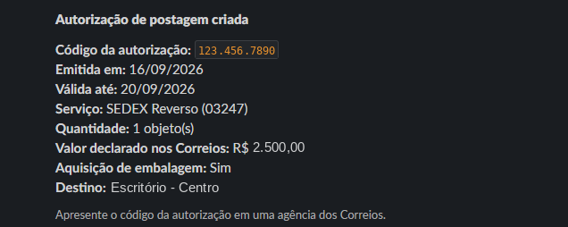
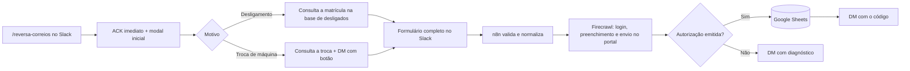
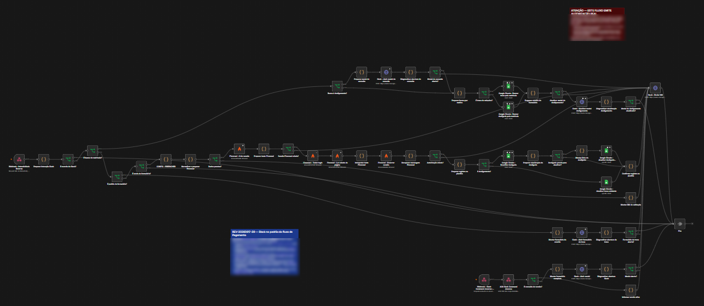
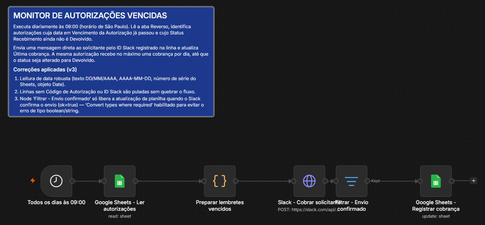

# 📦 Logística Reversa dos Correios via Slack

**Emissão de autorizações de SEDEX Reverso direto do Slack · n8n + Firecrawl (automação de navegador) + Google Sheets**

Automação criada para o Suporte Corporativo de TI de uma empresa de varejo com várias marcas. Toda devolução de equipamento (desligamento ou troca de máquina) exige um código de logística reversa dos Correios. Este fluxo permite que qualquer pessoa autorizada gere esse código pelo Slack, sem acessar o portal.

> Versão pública e sanitizada. Credenciais, código administrativo, cartão de postagem, endereços, telefones, CNPJ, IDs de planilha, caminhos de webhook e credenciais do n8n foram substituídos por valores de exemplo. Os prints usam dados fictícios.

## 📌 O problema

A emissão dependia de alguém entrar no portal dos Correios e preencher remetente, destinatário, valor declarado e dados da coleta, pedido por pedido. Só quem tinha acesso à conta conseguia fazer, o que criava fila e dependência de uma única pessoa.

O caminho ideal seria a API de logística reversa dos Correios, mas o acesso não foi liberado.

## 💡 A solução: não esperar a API

Se uma pessoa consegue fazer pelo site, uma automação também consegue. O fluxo usa uma **sessão de navegador do Firecrawl** que faz login no portal, preenche o formulário de SEDEX Reverso, envia e captura o código de autorização emitido. Quando a API estiver disponível, basta trocar essa etapa do fluxo.



## ⚙️ Como funciona



1. A pessoa digita `/reversa-correios`, escolhe o motivo e informa a matrícula.
2. O fluxo busca os dados do colaborador e do equipamento na planilha de controle e abre o formulário já preenchido.
3. Ao enviar, o n8n valida os campos, abre uma sessão de navegador no Firecrawl e executa o preenchimento no portal.
4. Com a autorização emitida, registra código, validade e status na planilha e entrega tudo por mensagem direta no Slack.
5. Se algo falhar (CAPTCHA, mudança no portal, campo obrigatório ausente), a pessoa recebe um diagnóstico em vez de um erro silencioso.



### Monitor de autorizações vencidas

Um segundo workflow roda todos os dias às 9h. Ele identifica autorizações vencidas cujo equipamento ainda não foi devolvido e cobra o solicitante por mensagem direta, com no máximo uma cobrança por dia. A planilha só é atualizada depois que o Slack confirma o envio.



## 🧠 Decisões técnicas

- **Automação de navegador no lugar da API.** Destrava o processo hoje, isolada em uma etapa que pode ser substituída depois.
- **Fim do `expired_trigger_id`.** O Slack só aceita abrir um modal até 3 segundos depois do comando. O webhook responde na hora, abre uma tela leve de "Consultando a matrícula…" e só então consulta a planilha, atualizando o modal com `views.update`.
- **Webhook de interatividade separado**, com resposta HTTP 200 imediata.
- **Bloqueio de autorização duplicada** para o mesmo equipamento.
- **Sessão de navegador sempre encerrada**, com timeout e diagnóstico quando o portal muda.
- **Datas tolerantes a formato** (texto DD/MM/AAAA, AAAA-MM-DD, número de série do Sheets) no monitor.
- **Idempotência na cobrança:** uma cobrança por dia por autorização, até o status mudar para Devolvido.

## 📁 Estrutura

```
.
├── n8n/
│   ├── logistica-reversa-correios.workflow.json     # fluxo principal
│   └── monitor-autorizacoes-vencidas.workflow.json  # cobrança diária
└── docs/
    ├── configuracao.md
    └── img/
```

## 🚀 Como usar

O passo a passo de importação, configuração do app do Slack, variáveis de ambiente e colunas da planilha está em [`docs/configuracao.md`](docs/configuracao.md).

## 🛠️ Stack

**n8n** · **Firecrawl Browser** · **Slack** (Slash Commands, Block Kit, `views.open`, `views.update`, `chat.postMessage`) · **Google Sheets** · **JavaScript**

---

Desenvolvido por **Henrique Silva** · [GitHub](https://github.com/Hsilva68) · [LinkedIn](https://www.linkedin.com/in/henrique-silva-068b121ab/) · [Automation Hub](https://automacoes.henrishowautomate.work/)
